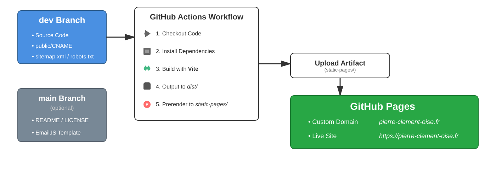

# Portfolio - Pierre Clément

Welcome to my personal portfolio website built with **React + Vite** and deployed on **GitHub Pages**.

## Live Site

[https://pierre-clement-oise.fr](https://pierre-clement-oise.fr)

## Project Overview

This project showcases my work and skills as a developer. It is built with:

- **React** for UI
- **Vite** as the build tool
- **jankojjs/react-static-prerender** for prerendring the website
- **GitHub Actions** for CI/CD
- **GitHub Pages** for hosting

---

## CI/CD Workflow

The site is automatically built and deployed whenever changes are pushed to the `dev` branch. The `main` branch contains the documentation and the EmailJS notification template; it does not deploy the site.

Below is a visual representation of the workflow:



**Workflow Steps:**

1. Push code to `dev` branch  
2. GitHub Actions:
   - Checkout code
   - Install dependencies
   - Run lint and content tests
   - Generate brand assets, build Vite and prerender French and English pages (`npm run prerender`)
   - Run browser checks with EmailJS requests mocked
   - Upload `static-pages/` folder as artifact
   - Deploy to GitHub Pages
3. GitHub Pages serves the site at your custom domain.

---

## Branch Structure

- **dev**: Source code, triggers build & deployment  
- **main**: Documentation and `emailjs.html`, not used for deployment

---

## Deployment

- **GitHub Actions** automatically handles CI/CD  
- **Custom Domain**: `pierre-clement-oise.fr` via `public/CNAME`  
- **Vite `base` configuration**: set to `/` for custom domain

---

## Local Setup

To run the project locally:

```bash
git clone https://github.com/KadenHD/portfolio.git
git checkout dev
nvm use
npm ci
npm run dev
```

To build locally:

```bash
npm run build
```

To prerender locally:

```bash
npm run prerender
```

This generates the public brand assets, builds the app and prerenders both `/` and `/en/` into `static-pages/`.

To run the project locally as production:

```bash
npm run preview
```

---

## Environment Variables

This project uses [**EmailJS**](https://www.emailjs.com/) for the contact form.

The following environment variables are required and must be prefixed with `VITE_`
(because they are injected at build time by Vite):

- `VITE_EMAILJS_SERVICE_ID`
- `VITE_EMAILJS_TEMPLATE_ID`
- `VITE_EMAILJS_PUBLIC_KEY`

### Local Development

Create a `.env` file at the project root:

```env
VITE_EMAILJS_SERVICE_ID=your_service_id
VITE_EMAILJS_TEMPLATE_ID=your_template_id
VITE_EMAILJS_PUBLIC_KEY=your_public_key
```

### Production (GitHub Pages)

These variables are stored as GitHub Actions Secrets and injected during the
`npm run build` step of the CI/CD workflow.

## EmailJS Notification Template

The recipient-facing template is maintained in [`emailjs.html`](./emailjs.html) on `main`. It uses the portfolio’s white, navy and orange identity, with clear contact details, a readable multiline message and a reply link.

Copy it into the EmailJS template editor and set **Reply To** to `{{email}}`. The form sends `name`, `email` and `message`; it does not send `time`. Updating this repository does not update the EmailJS dashboard automatically.

See [the setup and verification guide](./docs/emailjs.md) for the subject, sender, recipient and test settings. The `.gitignore` also applies on `main` so local build files, dependencies, environment files and private working records stay excluded when switching branches.

---

## Notes

- `dist/` and `static-pages/` are never committed; CI/CD handles deployment
- CNAME file must be in `public/` for custom domain
- `main` maintains documentation and the EmailJS template independently of the deployed site

---

## License

[MIT License](./LICENSE)
