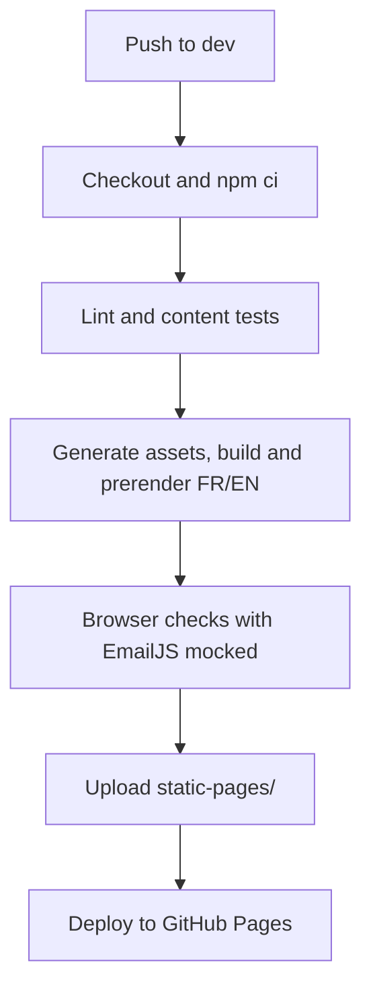

# Portfolio - Pierre Clément

Bilingual portfolio built with React and Vite, prerendered in French and English and deployed to GitHub Pages.

[Portfolio in French](https://pierre-clement-oise.fr/) · [Portfolio in English](https://pierre-clement-oise.fr/en/)

## Repository layout

| Branch | Purpose |
| --- | --- |
| [`dev`](https://github.com/KadenHD/portfolio/tree/dev) | Website source, assets, tests and deployment workflow |
| `main` | Repository overview, licence and EmailJS notification template |

The detailed development, SEO and maintenance instructions live in the [`dev` README](https://github.com/KadenHD/portfolio/blob/dev/README.md). Website changes are made on `dev`; `main` does not deploy the site.

## Local development

Node 24.21.0 is defined in the source branch’s `.nvmrc`. With nvm installed:

```sh
git clone --branch dev https://github.com/KadenHD/portfolio.git
cd portfolio
nvm use
npm ci
npm run dev
```

To build and preview the prerendered French and English pages:

```sh
npm run preview:seo
```

This generates the site and serves `static-pages/` at `http://127.0.0.1:5175`, including a distinct `/en/` page. The local preview sends `noindex, nofollow` headers and keeps the public canonical URLs. See the [source README](https://github.com/KadenHD/portfolio/blob/dev/README.md) for devbox access.

`npm run build` generates the Vite bundle in `dist/`; `npm run prerender` generates the complete bilingual delivery in `static-pages/`. `npm run preview` previews the Vite bundle and its SPA fallback, rather than the two prerendered HTML pages.

## Deployment

A push to `dev` runs the [GitHub Actions workflow](https://github.com/KadenHD/portfolio/blob/dev/.github/workflows/static.yml):



The custom domain is declared in `public/CNAME` on `dev`. Only `static-pages/` is uploaded; build directories, dependencies, environment files and private working records are excluded from version control.

## EmailJS notification template

The notification received by Pierre is maintained in [`emailjs.html`](./emailjs.html). See the [EmailJS setup guide](./docs/emailjs.md) for sender, recipient, subject and reply settings.

The frontend sends `name`, `email` and `message`. Set **Reply To** to `{{email}}` and keep a fixed recipient. Copy the HTML into the EmailJS dashboard manually: committing this file does not update the hosted template.

The `VITE_EMAILJS_SERVICE_ID`, `VITE_EMAILJS_TEMPLATE_ID` and `VITE_EMAILJS_PUBLIC_KEY` values are public frontend identifiers injected during the build. Never put private credentials in `VITE_*` variables. Without a complete EmailJS configuration, the form prepares an email draft instead. The [source `.env.example`](https://github.com/KadenHD/portfolio/blob/dev/.env.example) contains placeholders only.

## Licence

[MIT licence](./LICENSE).
